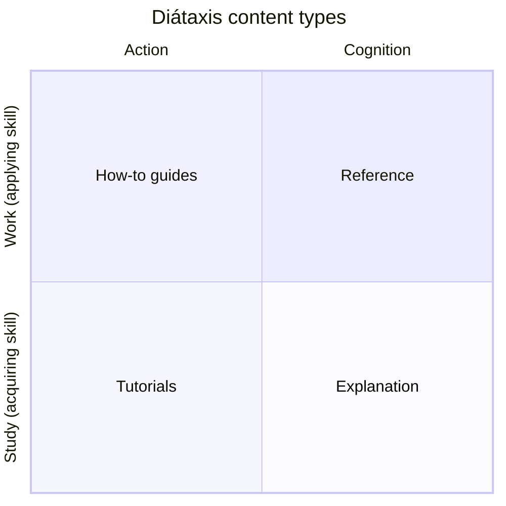

# Documentation methodology

The pages on this site follow two public frameworks. Each one answers a different question:

| Framework | Question it answers |
|---|---|
| [Google developer documentation style guide](https://developers.google.com/style) | How should this sentence read? |
| [Diátaxis](https://diataxis.fr/) | What kind of page is this, and where does it go? |

A style guide alone gives you good sentences on pages that are hard to find. A taxonomy alone gives you a clean structure with pages that are tiring to read. I use both.

## Google developer documentation style guide

### What it is

The [Google developer documentation style guide](https://developers.google.com/style) is the public style guide that Google's developer documentation teams use. Many API documentation teams outside Google adopt it because it targets a specific reader: someone who might not be a native English speaker, might be using a screen reader, and is probably scanning for a code sample.

### The rules I lean on most

- **Second person, active voice, present tense.** "The API returns a token," not "A token will be returned by the API."
- **Sentence case.** For headings, buttons, and UI strings: "Manage your usage," not "Manage Your Usage."
- **No filler.** Words like "just," "simply," "easily," and "please" either add nothing or assume the reader finds the task easy.
- **"Can" for ability, "may" only for permission.**
- **No Latin abbreviations.** "For example" instead of "e.g.," and "that is" instead of "i.e."
- **Realistic examples.** Values that look like real data, never `foo` or `bar`.

### Why I use it

It settles hundreds of small decisions in advance, such as capitalization, voice, commas, and list format, so review time goes to accuracy. In a docs-as-code workflow it also gives reviewers something to cite. A pull request comment can link to a rule instead of turning into a debate about taste.

### Where to see it on this site

- Sentence-case headings across the [integration guide](/docs/integration-guide) and the [hardware install guide](/docs/databridge/databridge-installation-guide-atlas-insight).
- Imperative steps in tutorials and how-to guides: "Tap **Connect**," not "You should tap Connect."
- Realistic payloads in the [API reference](/docs/api/powerbox-api), with field names and values from a believable utility data model.
- A list of [words to avoid](/docs/writing-guideline#72-words-to-avoid) in the site's writing guideline, checked by Vale on every pull request.

## Diátaxis

### What it is

[Diátaxis](https://diataxis.fr/) is a documentation framework by Daniele Procida. It sorts technical documentation into four types, based on two questions: is the reader acting or thinking, and are they learning or working?

| Type | Purpose | The reader is thinking | The page has to |
|---|---|---|---|
| **Tutorial** | Learning by doing | "I'm new. Teach me." | Lead to a result that works, every time |
| **How-to guide** | Reaching a goal | "I know the basics. Show me the steps." | Solve one real problem and skip the basics |
| **Reference** | Looking something up | "I need a fact." | Be accurate and complete, with no story |
| **Explanation** | Understanding | "Help me make sense of this." | Give context, history, and trade-offs |

### One page, one type

The rule that matters most is that each page is one type. When a page mixes a tutorial with a reference, beginners get buried in detail and experienced readers wade through hand-holding. When a how-to drifts into explanation, the reader who wants the steps has to skip paragraphs to find them. Asking "what is this page for?" before writing catches most of these problems.

### Where to see it on this site

| Page | Type | Notes |
|---|---|---|
| [Integration guide](/docs/integration-guide) | Explanation and how-to | A deliberate exception. Integration teams read it start to finish, so the architecture and the steps share one page, in separate sections. |
| [API reference](/docs/api/powerbox-api) | Reference | Generated from OpenAPI. No narrative. |
| [Hardware install guide](/docs/databridge/databridge-installation-guide-atlas-insight) | How-to | Assumes the device is in your hands. |
| [Data dictionary](/docs/data-dictionary) | Reference | Fields and storage locations. |
| [BillSense AI](/docs/billsense-ai/overview) | Explanation and how-to | The overview and the troubleshooting steps are separate pages. |
| [PIX](/docs/pix/about-pix) | All four | One tutorial, one how-to, one reference, and one explanation, each on its own page. |
| [Writing guideline](/docs/writing-guideline) | Reference | Rules to look up while writing. |

If you find a page that mixes types without a reason, I'd treat it as a bug.

## Using both

| Level | Question | Framework |
|---|---|---|
| Word | Which word? | Google |
| Sentence | Active or passive? | Google |
| Page | Tutorial or reference? | Diátaxis |
| Site | Where does this page belong? | Diátaxis |

## Where I've applied this

| Where | What I did |
|---|---|
| **Lean Tech / Crane Worldwide Logistics** (Feb 2026 to present) | Senior technical writer (contract). I own the documentation lifecycle and knowledge governance for Crane Worldwide's operational knowledge base in Doc360, working with business analysts and subject matter experts in three regions. |
| **L'Oréal France** (Nov 2025 to Feb 2026) | Defined the documentation strategy for L'Oréal's data infrastructure: dataflows, database schemas, and the lineage from SQL views to Power BI. Moved a team that relied on SharePoint to docs-as-code, with Markdown, Git, Vale-style linting, and code samples validated in CI. |
| **Sephora LATAM** (through Amaris Consulting, 2024 to 2025) | Led the redesign of the documentation architecture for Sephora's retail platforms in Latin America using TOGAF, with one standard across 5+ countries. Redundant documentation dropped by about 30%, measured with a Confluence content audit. Migrated legacy content to Docusaurus and mentored 3 junior writers in docs-as-code. |
| **Itaú Unibanco** (through Zup Innovation, 2022 to 2024) | Owned the official documentation for the PIX APIs, Brazil's instant-payments system (BRL 17T+ a year, 150M+ users). Wrote 37+ endpoint references, integration guides, release notes, and migration guides in a Bitbucket docs-as-code pipeline. Level 1 support tickets on the PIX integration queue fell about 45% in the six months after launch, and developer satisfaction with the docs rose from 3.8 to 4.6 out of 5 (n=60+, quarterly developer experience survey). |
| **Infomed Benner** (2021 to 2022) | Documentation analyst for healthcare software. Rebuilt the documentation framework, rewrote system manuals in plainer language, and took part in software quality control. |
| **This site** | EnergyGrid applies both frameworks to six kinds of reader: developers, integrators, field technicians, end users, support agents, and people who use AI tools with the docs. PIX covers the full Diátaxis set in a domain I worked in. |

### What the work involves

Moving a team onto these frameworks is mostly practical work:

- **Auditing existing docs against Diátaxis** to find pages that try to do two jobs, and proposing how to split them.
- **Writing an adoption plan for the style guide** that works for writers, engineers, and product managers, who each need a different starting point.
- **Setting up review in docs-as-code**, so that style and page-type problems surface in the pull request, before publication.
- **Coaching engineers** to write references that stay references and tutorials that stay tutorials.

If you're rebuilding a documentation system, [get in touch on LinkedIn](https://www.linkedin.com/in/leandro-gabriel-8aab31167/).

## Further reading

- [Google developer documentation style guide](https://developers.google.com/style)
- [Diátaxis](https://diataxis.fr/), with an essay on each content type
- [Writing guideline](/docs/writing-guideline), this site's applied style guide
- [The Documentation System](https://documentation.divio.com/), Daniele Procida's earlier version of the framework
