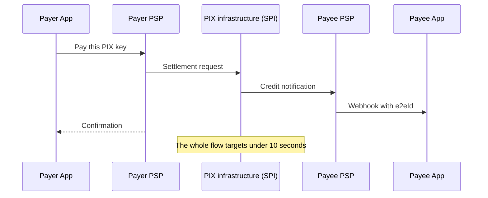
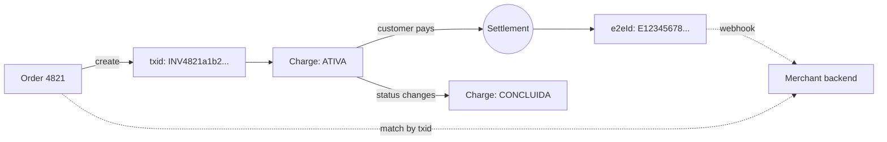

# About PIX

PIX is Brazil's instant-payments system, run by the [Banco Central do Brasil](https://www.bcb.gov.br/en/financialstability/pix_en) (BCB). It moves money between accounts at hundreds of banks and fintechs in a few seconds, at any hour, on any day, including weekends and holidays.

This page explains how PIX works and why its API looks the way it does. It's written for people who design, document, or integrate payment APIs. It doesn't teach a specific API. For that, follow [Send your first PIX payment](./tutorial-first-payment).

## Why PIX exists

Before November 2020, moving money between Brazilian banks was slow. TED transfers settled on the same day, but only during banking hours. DOC transfers settled the next business day. Anything outside those windows waited.

PIX replaced that with one system that:

- Settles each payment individually, in seconds.
- Runs 24 hours a day, every day of the year.
- Is free for individuals. Businesses pay their own bank's fees, which are usually lower than card fees.
- Uses identifiers people already know, like a phone number, an email address, or a tax ID, instead of branch and account numbers.

It launched in November 2020 and reached [over a billion transactions a month](https://www.bcb.gov.br/en/financialstability/pix_en) within its first year. Today it's one of the largest instant-payment systems in the world, alongside India's UPI.

## Who's involved

Every PIX payment has two sides:

- The **payer**, who sends the money.
- The **payee**, the merchant or person who receives it.

Each side has an account at an institution licensed by the BCB, called a **payment service provider (PSP)**. Only PSPs connect to the central infrastructure. Everyone else, including merchants and most fintechs, integrates through a PSP's API.



## What you integrate with

When a developer says they're "integrating PIX," they almost always mean a PSP's API, not the central infrastructure. The infrastructure is a [message network run by the BCB](https://www.bcb.gov.br/estabilidadefinanceira/pix) that only licensed institutions can join. PSPs expose an API on top of it for their business customers.

The BCB publishes a [standard for that PSP API](https://bacen.github.io/pix-api/). Its main resources:

| Resource | Purpose |
| --- | --- |
| `cob` | An immediate charge: a payment request the merchant creates and the customer pays. |
| `cobv` | A charge with a due date, and optional fines, interest, and discounts. |
| `pix` | A received payment, looked up by its `e2eId`. |
| `webhook` | A URL the PSP calls when a payment to a given key settles. |
| `lote` | A batch of due-date charges, for merchants with high volume. |

The [Instant Payments API sample](/docs/api/pix-api/instant-payments-api-pix-sample) on this site covers part of that standard: enough to create a charge, receive the payment, and reconcile it.

## PIX keys

A **PIX key** (`chave`) is an alias that points to a bank account. There are five types. The type decides who can register the key and how apps should show it:

| Type | Format | Who can register it | How apps show it |
| --- | --- | --- | --- |
| **CPF** | 11 digits | The person who owns the CPF | Partly masked, for example `***.456.789-**` |
| **CNPJ** | 14 digits | The company that owns the CNPJ | In full |
| **Email** | An email address | Anyone, after confirming the address | In lowercase |
| **Phone** | E.164, starting with `+55` | Anyone, after confirming by SMS | In international format |
| **Random key (EVP)** | A UUID generated by the PSP | Anyone | As a value to copy, rarely in full |

When a payer enters a key, their PSP looks it up in **DICT**, the key directory run by the BCB, to find which PSP holds the account and where to send the payment.

An account can have up to 5 keys if it belongs to a person, and up to 20 if it belongs to a company. A key can point to only one account.

### Why random keys exist

The random key, *chave aleatória*, is there for privacy. People who don't want to share their phone, email, or tax ID with whoever pays them use a random key instead. It's harder to read out over the phone and impossible to memorize, so apps share it as text to copy or as a QR code.

## End-to-end ID

Every settled payment gets an **end-to-end ID** (`e2eId`), and its format is fixed:

```
E + ISPB (8) + yyyyMMddHHmm + suffix (11)
```

| Part | Meaning |
| --- | --- |
| `E` | Fixed prefix |
| `ISPB` | The 8-digit code that identifies the payer's institution in the Brazilian payment system |
| `yyyyMMddHHmm` | Creation time in UTC, to the minute |
| `suffix` | 11 alphanumeric characters, unique within that minute |

The `e2eId` is the identifier to reconcile on. Webhooks, refund requests, and audit trails all reference it. If you store only one field about a PIX payment, store the `e2eId`.

## Charges and the `txid`

A `cob` is a payment request. The merchant creates it, and the central infrastructure doesn't know about it until someone pays. Each charge has a `txid`: an ID the merchant chooses, 26 to 35 letters and digits long, unique at that PSP for at least 365 days.

How they relate:

- One `txid` has at most one charge, and a charge has at most one settled `e2eId`.
- An `e2eId` has at most one `txid`. A PIX sent without a charge has none.

Merchants use the `txid` to connect a charge to their own order. The payment system uses the `e2eId` to identify the payment.



## What "instant" means

The 10-second target covers the whole flow, from the moment the payer's PSP sends the payment to the moment the payee's PSP confirms the credit. Most of that time goes to processing inside each PSP.

This has consequences for integrators:

- **Payments can't be undone.** A settled PIX can't be reversed. A refund (*devolução*) is a new transaction that references the original. The BCB's special return mechanism (MED) covers fraud cases, through the PSPs.
- **Rely on webhooks, not polling.** Polling `GET /cob/{txid}` shows the status change from `ATIVA` to `CONCLUIDA`, but the webhook arrives sooner and carries the payment details.
- **Expect duplicates.** The central infrastructure settles each `e2eId` once, but a PSP can deliver the same webhook more than once. If you credit a customer twice, the only fix is a refund, which is another PIX. [Handle PIX webhooks](./how-to-handle-webhooks) shows how to avoid that.

## Why the API looks the way it does

Some conventions in the PIX standard surprise developers used to card APIs:

- **The merchant chooses the `txid`.** The client creates the charge with `PUT /cob/{txid}` at a URL it picked. A retry after a timeout hits the same URL instead of creating a second charge. A retry with the same body succeeds, and a different body returns `409`. A point-of-sale system can also create the ID before it has a connection.
- **`PUT` creates, `PATCH` changes.** That follows from the point above: the client knows the resource's URL in advance.
- **Amounts are strings.** For example, `"valor": { "original": "150.00" }`. JSON numbers are often parsed as floating point, which can't represent every decimal exactly. A string keeps the amount exact.
- **Field names are in Portuguese:** `cob`, `chave`, `devedor`, `valor`, `solicitacaoPagador`. PIX is national infrastructure, and the standard was written for Brazilian developers first.

Each of these choices prevents a kind of bug that shows up at high volume.

## Further reading

- [Banco Central do Brasil: PIX overview, in English](https://www.bcb.gov.br/en/financialstability/pix_en)
- [PIX PSP API standard, in Portuguese](https://bacen.github.io/pix-api/), the public OpenAPI specification the sample on this site is based on
- [BR Code manual](https://www.bcb.gov.br/estabilidadefinanceira/spb_pix), with the QR code format used in PIX charges
- [Send your first PIX payment](./tutorial-first-payment), a guided walkthrough in the sandbox
- [Handle PIX webhooks](./how-to-handle-webhooks), for a webhook listener ready for production
- [Instant Payments API reference](/docs/api/pix-api/instant-payments-api-pix-sample), the sample OpenAPI spec for this section
