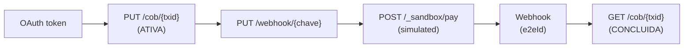

# Send your first PIX payment

In this tutorial you create a charge in the sandbox of the [Instant Payments API sample](/docs/api/pix-api/instant-payments-api-pix-sample), pay it with a simulated customer, receive the webhook, and reconcile the payment. By the end you'll have:

- An OAuth access token
- A charge, with its `txid`
- A webhook listener that receives payment notifications
- A settled payment with its `e2eId`, matched to the charge

You'll use `curl`, `jq`, and a short Node.js script for the webhook. Any HTTP client and language work if you prefer others.

If you want to understand PIX itself first, read [About PIX](./about-pix).

:::tip Try it in the browser
Every call except the webhook delivery also works on the [API reference pages](/docs/api/pix-api/instant-payments-api-pix-sample), in a sandbox the site simulates in your browser. Use any value as the token there.
:::

## Before you begin

- Node.js 20 or later, `curl`, and `jq`. To install `jq`, run `brew install jq` on macOS or `sudo apt install jq` on Debian and Ubuntu.
- An [ngrok](https://ngrok.com/) account. The free plan is enough.
- An empty folder:

    ```bash
    mkdir pix-tutorial && cd pix-tutorial
    ```

The sandbox doesn't move real money, so you can repeat any step.

## Step 1: Get an access token

1. **Request sandbox credentials**

    Email `pix-sandbox@instant-payments.example` with the subject `Sandbox access`. You get a `client_id` and a `client_secret` within one business hour.

    :::note
    This API is a portfolio sample, so this request flow is illustrative. The token request in the next steps is the one you'd make to a real PSP.
    :::

2. **Save them as environment variables**

    ```bash
    export PIX_CLIENT_ID=<your-client-id>
    export PIX_CLIENT_SECRET=<your-client-secret>
    export PIX_BASE_URL=https://sandbox.instant-payments.example/v2
    ```

3. **Request a token**

    PSPs use the OAuth 2.0 client credentials grant. Ask for the scopes this tutorial uses:

    ```bash
    PIX_TOKEN=$(curl -sS -X POST \
      "${PIX_BASE_URL%/v2}/oauth/token" \
      -u "$PIX_CLIENT_ID:$PIX_CLIENT_SECRET" \
      -d "grant_type=client_credentials&scope=cob.write cob.read pix.read webhook.write" \
      | jq -r .access_token)

    echo "Token: ${PIX_TOKEN:0:12}…"
    ```

    Expected output:

    ```text
    Token: eyJhbGciOiJ…
    ```

    The token lasts about one hour. If a later step returns `401`, request a new one.

## Step 2: Create a charge

A charge (`cob`) is a payment request that the customer pays. You choose its ID, the `txid`.

1. **Create a `txid`**

    ```bash
    export TXID=tutorial$(date +%Y%m%d%H%M%S)$(openssl rand -hex 4)
    echo "txid: $TXID (length ${#TXID})"
    ```

    A `txid` has 26 to 35 letters and digits. This one has 30.

2. **Create the charge**

    ```bash
    curl -sS -X PUT \
      "$PIX_BASE_URL/cob/$TXID" \
      -H "Authorization: Bearer $PIX_TOKEN" \
      -H "Content-Type: application/json" \
      -d '{
        "calendario": { "expiracao": 3600 },
        "valor": { "original": "12.50" },
        "chave": "merchant@example.com",
        "solicitacaoPagador": "Tutorial run"
      }' | tee charge.json | jq .status
    ```

    Expected output:

    ```text
    "ATIVA"
    ```

    The full response is in `charge.json`. `ATIVA` means the charge is waiting for payment, for the next 3,600 seconds. `loc.location` is the payload a banking app reads from the QR code.

The key `merchant@example.com` is already registered to your sandbox client. In production, you use a PIX key registered to your own account.

## Step 3: Set up a webhook listener

When the payment settles, the PSP sends a webhook. Start a small server that prints what it receives, and make it reachable over HTTPS.

1. **Write the listener**

    Create `webhook.js`:

    ```javascript
    const http = require('http');

    http.createServer((req, res) => {
      let body = '';
      req.on('data', (chunk) => (body += chunk));
      req.on('end', () => {
        console.log(`\n${new Date().toISOString()}  ${req.method} ${req.url}`);
        try {
          console.log(JSON.stringify(JSON.parse(body), null, 2));
        } catch {
          console.log(body || '(empty body)');
        }
        res.writeHead(200, { 'Content-Type': 'application/json' });
        res.end('{"received":true}');
      });
    }).listen(3000, () => console.log('Listening on http://localhost:3000'));
    ```

    Run it:

    ```bash
    node webhook.js
    ```

2. **Expose it with ngrok**

    In a second terminal:

    ```bash
    ngrok http 3000
    ```

    Expected output:

    ```text
    Forwarding  https://a1b2c3.ngrok.io -> http://localhost:3000
    ```

3. **Register the webhook**

    Replace the URL with the one ngrok printed:

    ```bash
    export NGROK_URL=https://a1b2c3.ngrok.io

    curl -sS -X PUT \
      "$PIX_BASE_URL/webhook/merchant@example.com" \
      -H "Authorization: Bearer $PIX_TOKEN" \
      -H "Content-Type: application/json" \
      -d "{ \"webhookUrl\": \"$NGROK_URL/pix-callback\" }" | jq
    ```

    Expected output:

    ```json
    {
      "webhookUrl": "https://a1b2c3.ngrok.io/pix-callback",
      "chave": "merchant@example.com",
      "criacao": "2026-04-24T18:32:11Z"
    }
    ```

    A key has one webhook at most, so running this again replaces the URL. Following the PIX standard, the PSP adds `/pix` to the end of the URL when it calls you, so notifications arrive at `/pix-callback/pix`.

## Step 4: Pay the charge

In real life, the customer scans the QR code with their banking app. The sandbox has a helper endpoint that does it for you.

1. **Simulate the payment**

    ```bash
    curl -sS -X POST \
      "$PIX_BASE_URL/_sandbox/pay/$TXID" \
      -H "Authorization: Bearer $PIX_TOKEN" \
      -H "Content-Type: application/json" \
      -d '{ "pagador": { "cpf": "12345678909", "nome": "João Tutorial" } }' \
      | jq -r .endToEndId
    ```

    Expected output:

    ```text
    E12345678202604241832A1B2C3D4E5F
    ```

    Save it for Step 5:

    ```bash
    export E2EID=E12345678202604241832A1B2C3D4E5F
    ```

2. **Check the webhook**

    In the terminal running `webhook.js`, the notification arrives within a few seconds. The body is a list, because one call can carry several payments:

    ```text
    2026-04-24T18:32:14.221Z  POST /pix-callback/pix
    {
      "pix": [
        {
          "endToEndId": "E12345678202604241832A1B2C3D4E5F",
          "txid": "tutorial20260424183205a1b2c3d4",
          "valor": "12.50",
          "horario": "2026-04-24T18:32:13Z"
        }
      ]
    }
    ```

:::warning Respond quickly
Return a `2xx` within 5 seconds. If you don't, the PSP retries with increasing delays for up to 24 hours, and you get the same payment again. [Handle PIX webhooks](./how-to-handle-webhooks) shows how to respond fast and process each payment once.
:::

## Step 5: Reconcile

The webhook tells you a payment arrived. The API confirms it.

1. **Read the charge again**

    ```bash
    curl -sS "$PIX_BASE_URL/cob/$TXID" \
      -H "Authorization: Bearer $PIX_TOKEN" \
      | jq '{ status, e2eId: .pix[0].endToEndId }'
    ```

    Expected output:

    ```json
    {
      "status": "CONCLUIDA",
      "e2eId": "E12345678202604241832A1B2C3D4E5F"
    }
    ```

    `CONCLUIDA` means the charge was paid. The charge now points to the payment, and the payment points back to the charge.

2. **Read the payment**

    ```bash
    curl -sS "$PIX_BASE_URL/pix/$E2EID" \
      -H "Authorization: Bearer $PIX_TOKEN" | jq
    ```

    Expected output:

    ```json
    {
      "endToEndId": "E12345678202604241832A1B2C3D4E5F",
      "txid": "tutorial20260424183205a1b2c3d4",
      "valor": "12.50",
      "horario": "2026-04-24T18:32:13Z",
      "pagador": {
        "cpf": "12345678909",
        "nome": "João Tutorial"
      }
    }
    ```

You created a charge, received the payment through a webhook, and confirmed it on both sides.

## What you built



A production integration makes the same calls. The part that has to scale is the webhook listener.

## Next steps

- [Handle PIX webhooks](./how-to-handle-webhooks): authentication, fast responses, processing each payment once, and recovering from an outage.
- [About PIX](./about-pix): keys, the `e2eId`, and why the API looks the way it does.
- [Instant Payments API reference](/docs/api/pix-api/instant-payments-api-pix-sample): every operation and field.

## Troubleshooting

| Problem | Cause | Fix |
| --- | --- | --- |
| `401` from `/oauth/token` | Wrong `client_id` or `client_secret` | Export the variables again and check for trailing spaces. |
| `400` from `PUT /cob/{txid}` about `valor.original` | The amount was sent as a number | Send it as a string: `"original": "12.50"`. |
| `400` from `PUT /cob/{txid}` about the `txid` | The `txid` is shorter than 26 or longer than 35 characters, or has symbols | Create a new one with the command in Step 2. |
| `409` from `PUT /cob/{txid}` | You reused a `txid` with a different body | Create a new `txid`, or send exactly the same body again. |
| No webhook arrives | The ngrok URL changed after you registered it | Register the webhook again with the current URL. |
| The same `e2eId` arrives twice | The PSP retried because your listener was slow | Store each `e2eId` and skip ones you've seen. See [Process each payment once](./how-to-handle-webhooks#process-each-payment-once). |
