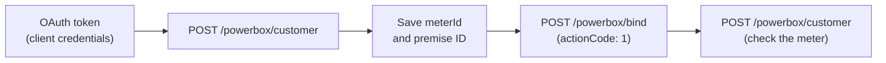

# Your first EnergyGrid integration in 30 minutes

In this tutorial you connect to the [PowerBox API](/docs/api/powerbox-api) sandbox and run the two flows every utility integration needs. By the end you'll have:

- An OAuth access token from the utility identity provider
- A customer synced from the utility's customer information system (CIS), with one premise and one meter
- A DataBridge Hub bound to that meter

You'll use `curl` and `jq` so you can copy each command as is. Any HTTP client works if you prefer another one.

If you'd like to understand how PowerBox fits into the platform before you start, read the [integration guide](/docs/integration-guide) first.

:::tip No terminal handy?
Each call in this tutorial is also on its [API reference page](/docs/api/powerbox-api), where you can send it from the browser. The site simulates the sandbox, so you don't need credentials there.
:::

## Before you begin

- A terminal with `curl` and `jq` installed. To install `jq`, run `brew install jq` on macOS or `sudo apt install jq` on Debian and Ubuntu.
- About 30 minutes.
- An empty folder for the tutorial:

    ```bash
    mkdir energygrid-tutorial && cd energygrid-tutorial
    ```

The sandbox uses synthetic customers and doesn't pair any physical device, so you can't break anything. You can repeat the customer sync as often as you like. Binding is different, and Step 4 explains how to start it over.

## Step 1: Get sandbox credentials

EnergyGrid doesn't issue tokens. The utility's identity provider (IDP) does, and the staging environment includes a synthetic IDP for testing.

1. **Request credentials**

    Email `powerbox-sandbox@energygrid.example` with the subject `Sandbox access`. You get a `client_id` and a `client_secret` within one business hour.

    :::note
    This API is a portfolio sample, so this request flow is illustrative. The OAuth call in Step 2 is the one you'd make against a real utility IDP.
    :::

2. **Save them as environment variables**

    ```bash
    export ENERGY_CLIENT_ID=<your-client-id>
    export ENERGY_CLIENT_SECRET=<your-client-secret>
    export ENERGY_BASE_URL=https://staging.api.energygrid.example/v1
    export ENERGY_IDP_URL=https://idp.staging.energygrid.example
    ```

    `ENERGY_BASE_URL` points to staging. Production is at `https://api.energygrid.example/v1`, and your sandbox client can only read from it.

## Step 2: Get an access token

Back-office flows like customer sync and binding use the OAuth 2.0 **client credentials** grant. Customer sign-in uses a different grant, explained in [Configure authentication](/docs/integration-guide#step-2-configure-authentication-oauth).

Request a token with the two scopes this tutorial needs:

```bash
ENERGY_TOKEN=$(curl -sS -X POST \
  "$ENERGY_IDP_URL/oauth/token" \
  -u "$ENERGY_CLIENT_ID:$ENERGY_CLIENT_SECRET" \
  -d "grant_type=client_credentials&scope=customer.sync hardware.bind" \
  | jq -r .access_token)

echo "Token: ${ENERGY_TOKEN:0:12}…"
```

Expected output:

```text
Token: eyJhbGciOiJ…
```

The token lasts about one hour. If a later step returns `401`, run this step again.

## Step 3: Sync a customer

This call asks PowerBox for a customer's profile from the CIS: the account, the service addresses (premises), and the meters at each one. If it works, EnergyGrid can read your CIS, and the rest of the tutorial depends on that.

1. **Run the sync**

    ```bash
    curl -sS -X POST \
      "$ENERGY_BASE_URL/powerbox/customer" \
      -H "Authorization: Bearer $ENERGY_TOKEN" \
      -H "Content-Type: application/json" \
      | tee customer.json | jq '{ clientId, AcctStatus, sites: (.customerSites | length) }'
    ```

    Expected output:

    ```json
    {
      "clientId": "123456789",
      "AcctStatus": "A",
      "sites": 1
    }
    ```

    The full response is now in `customer.json`. `"A"` means the account is active, and the sandbox customer has one premise.

2. **Save the meter and premise IDs**

    A premise can have several meters, such as electric and gas. You need one electric meter:

    ```bash
    export METER_ID=$(jq -r '.customerSites[0].meters[] | select(.meterType=="Electric") | .meterId' customer.json | head -n1)
    export PREMISE_ID=$(jq -r '.customerSites[0].externalSiteId' customer.json)

    echo "Premise: $PREMISE_ID"
    echo "Meter:   $METER_ID"
    ```

    Expected output:

    ```text
    Premise: 5113305555
    Meter:   123456789
    ```

Customer sync is idempotent on `clientId`. Running it again refreshes EnergyGrid's copy of the customer instead of creating a new one.

## Step 4: Bind a DataBridge Hub

Now link a DataBridge Hub to the meter from Step 3. In a real installation, the customer scans the QR code on the device and the utility's wireless mesh radio (the home area network) handles pairing. The sandbox accepts the values below and simulates that handshake.

1. **Send the bind request**

    ```bash
    export HEM_PROFILE_ID=$(jq -r '.clientId' customer.json)

    curl -sS -X POST \
      "$ENERGY_BASE_URL/powerbox/bind" \
      -H "Authorization: Bearer $ENERGY_TOKEN" \
      -H "Content-Type: application/json" \
      -d "{
        \"hemProfileId\": \"$HEM_PROFILE_ID\",
        \"macAddress\": \"70:B3:D5:4A:1C:9E\",
        \"installCode\": \"A1B2C3D4E5F6A7B8\",
        \"meterId\": \"$METER_ID\",
        \"actionCode\": 1
      }" -o /dev/null -w "%{http_code}\n"
    ```

    Expected output:

    ```text
    200
    ```

    A `200` means the utility's head-end accepted the request. Pairing itself happens afterward. In production it usually finishes within 15 minutes, and it can take up to 48 hours when the radio signal is weak.

2. **Sync again to check the meter**

    ```bash
    curl -sS -X POST \
      "$ENERGY_BASE_URL/powerbox/customer" \
      -H "Authorization: Bearer $ENERGY_TOKEN" \
      | jq --arg meter "$METER_ID" \
        '.customerSites[].meters[] | select(.meterId == $meter)'
    ```

    Expected output:

    ```json
    {
      "meterId": "123456789",
      "meterType": "Electric",
      "unitOfMeasure": "kWh",
      "isAMI": true,
      "rateCode": "RES1",
      "billingCycleId": 1
    }
    ```

    `isAMI: true` means the meter is on the AMI network, which is what the hub needs to read it.

:::caution Binding is not idempotent
Sending the same bind again returns `400` with `errorCode: METER_ALREADY_BOUND`. To start over, send the request with `"actionCode": 0` to release the meter, then send it again with `1`.
:::

## What you built



Four calls: a token, a customer sync, a bind, and a second sync. A production integration makes the same calls, at higher volume.

## Next steps

- [Integration guide](/docs/integration-guide): mTLS, JWT claims, bulk usage data, billing cycles, rate types, and error codes.
- [PowerBox API reference](/docs/api/powerbox-api): every request and response field and status code.
- [DataBridge Hub installation guide](/docs/databridge/databridge-installation-guide-atlas-insight): the customer's side of the bind you ran.

## Troubleshooting

| Problem | Cause | Fix |
| --- | --- | --- |
| `401` from `/oauth/token` | Wrong `client_id` or `client_secret` | Export the variables again and check for trailing spaces. |
| `401` from `/powerbox/customer` | The token expired | Repeat [Step 2](#step-2-get-an-access-token). |
| `403` from `/powerbox/customer` | The account is locked or closed (`AcctStatus` is `F`, `L`, or `Z`) | Use another sandbox customer, or ask the CIS team to reactivate the test account. |
| `400` from `/powerbox/bind` with `METER_ALREADY_BOUND` | The meter already has a device | Send `actionCode: 0` to release it, then bind again. |
| `400` from `/powerbox/bind` with `INVALID_INSTALL_CODE` | The install code doesn't match the MAC address | Check the device label, where both are printed together. In the sandbox, use the values from [Step 4](#step-4-bind-a-databridge-hub). |
| `customer.json` is empty after Step 3 | The request failed before returning JSON | Run the `curl` command without `tee` and read the error in the response. |
